# Customer Segmentation Through RFM-Based Clustering

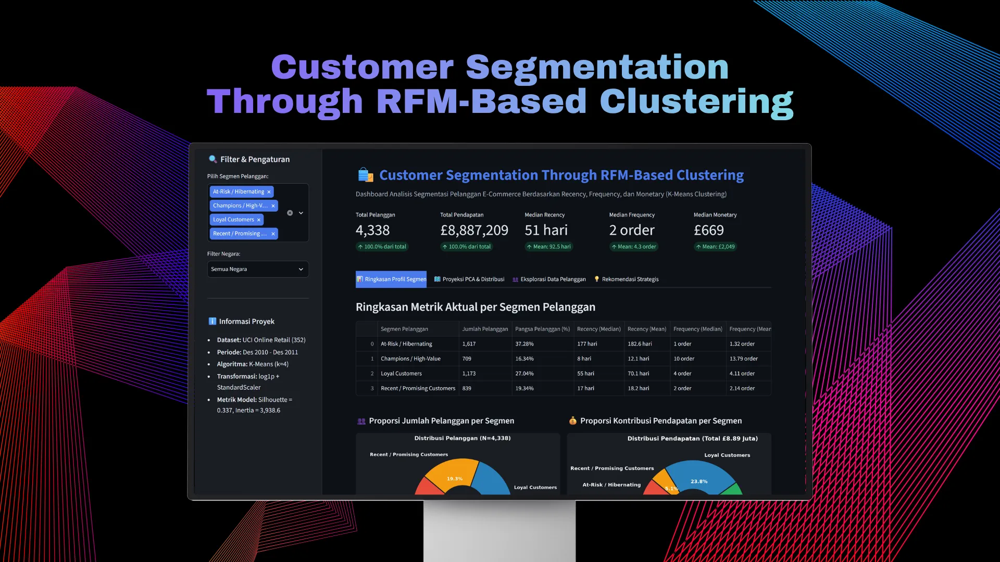


## Project Overview

Customer Segmentation Through RFM-Based Clustering is an end-to-end unsupervised machine learning pipeline and interactive analytics dashboard built for e-commerce transaction analysis. Using the UCI Online Retail dataset spanning December 2010 to December 2011, the project transforms raw invoice-level records into customer-level Recency, Frequency, and Monetary (RFM) behavioral profiles, applies skewness normalization and Z-score scaling, and segments 4,338 validated customers into four actionable clusters via K-Means clustering, complemented by Principal Component Analysis (PCA) projection and a four-tab Streamlit exploration dashboard.

## Problem Statement & Objectives

Uniform, one-size-fits-all marketing campaigns across heterogeneous e-commerce and wholesale customer bases create budget inefficiencies, missed upselling opportunities, and elevated churn risk. Without structured behavioral segmentation, retention teams cannot distinguish high-value wholesale buyers from low-frequency one-time purchasers or dormant accounts.

- Clean and audit 541,909 raw retail transaction rows into a verified purchase-only customer dataset free of missing IDs, duplicates, cancellations, and non-positive unit prices.
- Engineer customer-level Recency, Frequency, and Monetary (RFM) features anchored to an explicit post-observation reference date.
- Mitigate extreme right-skewness in transactional spending and order counts through logarithmic transformation (`log1p`) and Z-score standardization before distance-based clustering.
- Determine the optimal cluster count across `k = 2..10` using multi-criteria internal metrics (Inertia, Silhouette Score, Davies-Bouldin Index, and Calinski-Harabasz Index) and validate partition stability across random seeds.
- Profile resulting customer segments on both standardized and original business scales and surface interactive exploration and segment playbooks in a Streamlit dashboard.

## Data & Input Sources

The pipeline ingests the public UCI Online Retail transactional dataset stored locally at [dataset/original/Online_Retail.csv](dataset/original/Online_Retail.csv) along with dataset provenance metadata in [dataset/original/metadata.json](dataset/original/metadata.json) and [metadata.json](metadata.json). The raw dataset captures UK-registered non-store online retail transactions occurring between 1 December 2010 (08:26) and 9 December 2011 (12:50) across 38 countries, predominantly the United Kingdom (90.36% of valid customers).

| Attribute | Value |
| :--- | :--- |
| Dataset / Input Source | UCI Online Retail Dataset (UCI ID: 352, DOI: `10.24432/C5BW33`) |
| Source | [dataset/original/Online_Retail.csv](dataset/original/Online_Retail.csv) |
| Format | CSV (`ISO-8859-1` encoded) |
| Samples / Records | 541,909 raw transaction rows; 392,692 clean purchase rows; 4,338 unique customers |
| Features / Input Schema | 8 raw columns (`InvoiceNo`, `StockCode`, `Description`, `Quantity`, `InvoiceDate`, `UnitPrice`, `CustomerID`, `Country`) |
| Target / Label | None (unsupervised customer clustering on engineered RFM features) |

## Data Preprocessing & Feature Engineering

Because raw retail logs contain missing customer identifiers, redundant duplicate rows, order cancellations, returns, and extreme wholesale outliers, a strict cleaning funnel and statistical transformation pipeline are implemented in [src/customer_segmentation.py](src/customer_segmentation.py) prior to modeling. Across the 4,372 unique `CustomerID` values present in raw data, 34 accounts had only cancellation invoices or zero-price records and were excluded, leaving 4,338 valid purchasing customers representing 18,532 unique orders and £8,887,208.89 in gross purchase revenue.

| Transformation Stage | Input | Output | Key Impact |
| :--- | :--- | :--- | :--- |
| Missing Customer Filter | 541,909 raw rows | 406,829 rows | Removes 135,080 rows (24.93%) lacking `CustomerID` |
| Exact Deduplication | 406,829 rows | 401,604 rows | Removes 5,225 identical duplicate entries (1.28%) |
| Cancellation & Return Removal | 401,604 rows | 392,732 rows | Filters `InvoiceNo` starting with `'C'` and `Quantity <= 0` (8,872 rows) |
| Non-Positive Price Removal | 392,732 rows | 392,692 rows | Removes 40 rows with `UnitPrice <= 0` (samples/adjustments) |
| RFM Aggregation | 392,692 purchase rows | 4,338 customer records | Computes Recency (ref: `2011-12-10 12:50:00`), Frequency, and Monetary |
| `log1p` Normalization | Raw RFM features | Log-transformed RFM | Cuts skewness: Frequency `12.07 -> 1.21`, Monetary `19.34 -> 0.40`, Recency `1.25 -> -0.38` |
| Z-Score Standardization | `log1p` RFM matrix | Standardized RFM (`mu=0`, `sigma=1`) | Equalizes feature variance for Euclidean distance computation |

1. Parse `InvoiceDate` timestamps and filter out records with null `CustomerID` values so every transaction maps to an identifiable customer.
2. Drop exact duplicate rows across all columns (`drop_duplicates()`), then exclude cancellation invoices (`InvoiceNo` prefixed with `'C'`), non-positive quantities (`Quantity <= 0`), and non-positive unit prices (`UnitPrice <= 0`).
3. Compute line-item totals (`TotalAmount = Quantity * UnitPrice`) and aggregate by `CustomerID` relative to `ReferenceDate = max(InvoiceDate) + 1 day` (`2011-12-10 12:50:00`) to derive `Recency`, `Frequency` (`nunique` of `InvoiceNo`), `Monetary` (`sum` of `TotalAmount`), and modal `Country`.
4. Apply `np.log1p` to `Recency`, `Frequency`, and `Monetary` to compress heavy right tails, followed by `StandardScaler` normalization before clustering and PCA projection.

## Tech Stack

| Category | Technology | Purpose |
| :--- | :--- | :--- |
| Programming Language | Python | Core implementation of data pipeline and dashboard |
| Data Manipulation | Pandas, NumPy | Cleaning funnel, RFM aggregation, `log1p` transforms, summary tables |
| Machine Learning | Scikit-Learn | `StandardScaler`, `KMeans`, `AgglomerativeClustering`, `PCA`, internal cluster metrics |
| Static Visualization | Matplotlib, Seaborn | Publication-grade EDA, evaluation curves, heatmaps, and cluster plots |
| Interactive Dashboard | Streamlit | Four-tab dark-mode web interface for segment exploration and CSV export |

## Machine Learning Approach

This project formulates customer segmentation as an unsupervised centroid-based clustering problem over three behavioral dimensions (Recency, Frequency, Monetary). Because no ground-truth segment labels exist in transactional retail logs, clustering discovers natural customer groupings in standardized log-RFM space, paired with PCA dimensionality reduction solely for 2D visual inspection.

| Attribute | Specification |
| :--- | :--- |
| Learning Paradigm | Unsupervised Learning |
| Problem Domain | E-Commerce & Retail Customer Analytics |
| ML Task | Customer Segmentation (Clustering) |
| Input Space | 4,338 customers × 3 standardized `log1p(RFM)` features |
| Output Space | 4 discrete customer clusters mapped to business segment labels |
| Dimensionality Reduction | 2-component PCA (`PCA1`, `PCA2`) capturing 93.87% variance for visualization |

## Model Overview

The primary model is Scikit-Learn's `KMeans` algorithm fitted on standardized `log1p`-transformed RFM features, selected after comparing cluster counts `k = 2..10` and cross-checking partition structure against Ward-linkage `AgglomerativeClustering`.

| Attribute | Detail |
| :--- | :--- |
| Primary Model | K-Means Clustering (`sklearn.cluster.KMeans`) |
| Initialization & Restarts | `k-means++` initialization with `n_init=20` independent runs |
| Selected Cluster Count | `k = 4` |
| Random State | `42` (verified against 5 alternative seeds via Adjusted Rand Index) |
| Comparison Model | `AgglomerativeClustering(n_clusters=4, linkage='ward')` |
| Projection Model | `PCA(n_components=2, random_state=42)` |

## ML Workflow

The end-to-end analytical workflow implemented in [src/customer_segmentation.py](src/customer_segmentation.py), documented in [final_report.md](final_report.md), and served in [streamlit/app.py](streamlit/app.py) executes in the following stages:

1. **Raw Data Audit (`audit_data`)**: Inspects the 541,909 raw records for missing values, exact duplicates, cancellation prefixes, negative quantities, and non-positive prices.
2. **Purchase Cleaning Funnel (`clean_data`)**: Applies sequential filtering to retain 392,692 valid commercial purchase rows across 4,338 customers.
3. **RFM Feature Engineering (`calculate_rfm`)**: Aggregates transaction logs per `CustomerID` and exports [dataset/rfm_customer.csv](dataset/rfm_customer.csv) with assertions verifying non-negative Recency and strictly positive Frequency and Monetary values.
4. **Skewness Normalization & Scaling (`evaluate_clustering`)**: Applies `np.log1p` and `StandardScaler` to equalize RFM feature scales prior to distance calculations.
5. **Multi-`k` K-Means Sweep (`evaluate_clustering`)**: Fits `KMeans` for `k = 2..10`, computes Inertia, Silhouette Score, Davies-Bouldin Index, Calinski-Harabasz Index, and cluster size bounds, and exports [dataset/model_metrics.csv](dataset/model_metrics.csv).
6. **Stability & Cross-Algorithm Validation (`run_stability_and_validation`)**: Evaluates seed robustness across `[10, 99, 123, 777, 2024]` and compares `k = 4` K-Means partitions against Ward Agglomerative Clustering using Adjusted Rand Index (ARI).
7. **Segment Profiling & PCA Export (`build_final_segments`)**: Computes 2D PCA coordinates, summarizes segment statistics on the original RFM scale, maps clusters to four business segments, and writes [dataset/customer_segments.csv](dataset/customer_segments.csv).
8. **Visualization & Interactive Dashboard (`generate_visualizations`, [streamlit/app.py](streamlit/app.py))**: Generates 10 diagnostic figures in [figures/](figures) and powers the four-tab interactive Streamlit application.

## ML Pipeline Architecture

The pipeline progresses linearly from raw CSV ingestion through deterministic cleaning, statistical normalization, multi-criteria clustering evaluation, and dual analytical outputs (static diagnostic figures and an interactive Streamlit dashboard).

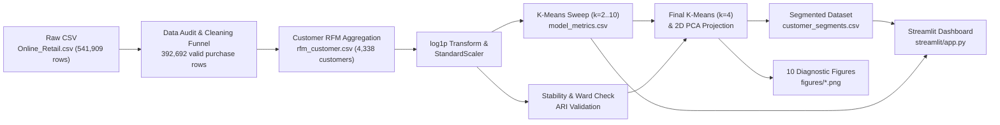

## Model Training & Configuration

Clustering is trained unsupervised on the full standardized `log1p(RFM)` matrix of 4,338 customers using `KMeans` with `k-means++` initialization and `n_init=20` restarts to prevent suboptimal local minima. The configuration below reflects the exact implementation in [src/customer_segmentation.py](src/customer_segmentation.py).

| Parameter / Setting | Configured Value | Role in Pipeline |
| :--- | :--- | :--- |
| Algorithm | `sklearn.cluster.KMeans` | Centroid-based Euclidean partitioning |
| `n_clusters` | `4` (swept across `2..10`) | Balances mathematical separation and actionable segments |
| `init` | `k-means++` (Scikit-Learn default) | Smart centroid initialization for faster convergence |
| `n_init` | `20` | Runs 20 centroid initializations and keeps lowest inertia |
| `random_state` | `42` | Reproducible centroid initialization and PCA computation |
| Feature Scaling | `np.log1p` + `StandardScaler` | Compresses heavy tails and enforces unit variance |
| PCA Projection | `PCA(n_components=2, random_state=42)` | Computes `PCA1` and `PCA2` for 2D visualization |

```python
rfm_log = np.log1p(rfm[['Recency', 'Frequency', 'Monetary']])
scaler = StandardScaler()
rfm_scaled = scaler.fit_transform(rfm_log)

km = KMeans(n_clusters=4, random_state=42, n_init=20)
labels = km.fit_predict(rfm_scaled)
```

## Model Comparison & Selection

To determine the optimal number of clusters and verify algorithmic consistency, the pipeline evaluates `KMeans` across `k = 2..10` using four internal validation metrics recorded in [dataset/model_metrics.csv](dataset/model_metrics.csv), and benchmarks the chosen `k = 4` solution against `AgglomerativeClustering(linkage='ward')`.

| `k` / Comparison | Inertia (WCSS) | Silhouette Score | Davies-Bouldin Index | Calinski-Harabasz Index | Cluster Size Range (Min–Max) |
| :---: | :---: | :---: | :---: | :---: | :---: |
| `k = 2` | 6,483.59 | 0.4328 | 0.8925 | 4,367.32 | 1,666 – 2,672 |
| `k = 3` | 4,869.49 | 0.3365 | 1.0483 | 3,625.30 | 769 – 1,872 |
| **`k = 4` (Selected)** | **3,938.60** | **0.3373** | **1.0106** | **3,328.92** | **709 – 1,617** |
| `k = 5` | 3,296.71 | 0.3162 | 0.9878 | 3,192.98 | 339 – 1,209 |
| `k = 6` | 2,855.53 | 0.3128 | 1.0156 | 3,082.28 | 333 – 962 |
| `k = 7` | 2,548.82 | 0.3092 | 0.9823 | 2,963.79 | 227 – 891 |
| `k = 8` | 2,336.34 | 0.3033 | 0.9892 | 2,827.07 | 214 – 856 |
| `k = 9` | 2,156.01 | 0.2811 | 1.0193 | 2,725.20 | 210 – 665 |
| `k = 10` | 2,000.57 | 0.2781 | 1.0237 | 2,647.38 | 93 – 642 |

While `k = 2` achieves the highest raw Silhouette Score (0.4328), it collapses the customer base into a coarse binary split ("active" vs. "inactive"). Selecting `k = 4` sits at the Inertia elbow inflection (where marginal WCSS drops slow from 930.9 at `k = 4` to 641.9 at `k = 5`), improves both Silhouette Score (0.3373 vs. 0.3365) and Davies-Bouldin Index (1.0106 vs. 1.0483) over `k = 3`, avoids degenerate micro-clusters (`min_cluster_size = 709` vs. `339` at `k = 5`), and isolates recent buyers from loyal and champion accounts. Cross-checking `k = 4` K-Means against Ward Agglomerative Clustering yields an Adjusted Rand Index (ARI) of `0.4303`, reflecting Ward's preference for uniform spherical variance versus K-Means' tighter adaptation to log-RFM density.

## Model Artifacts & Checkpoints

Rather than persisting serialized model weights (`.pkl` or `.joblib`), the pipeline exports reproducible tabular datasets and high-resolution diagnostic figures into the repository.

| Artifact Name | Format | Purpose | Location |
| :--- | :--- | :--- | :--- |
| Customer RFM Table | CSV | Customer-level Recency, Frequency, Monetary, and Country (`N = 4,338`) | [dataset/rfm_customer.csv](dataset/rfm_customer.csv) |
| Multi-`k` Evaluation Metrics | CSV | Inertia, Silhouette, Davies-Bouldin, Calinski-Harabasz, and cluster sizes (`k = 2..10`) | [dataset/model_metrics.csv](dataset/model_metrics.csv) |
| Segmented Customer Dataset | CSV | RFM values, `Cluster` ID, `PCA1`, `PCA2`, and `Segment_Name` per customer | [dataset/customer_segments.csv](dataset/customer_segments.csv) |
| Diagnostic Plots (10 Figures) | PNG | 300 DPI EDA, transformation, validation, PCA, and revenue share plots | [figures/](figures) |

## Model Evaluation & Results

Internal clustering validation, multi-seed stability testing, PCA variance analysis, and segment-level revenue profiling confirm a well-separated, stable, and commercially interpretable four-segment solution across all 4,338 customers.

| Evaluation Metric | Value | Scope / Interpretation |
| :--- | :--- | :--- |
| Inertia (WCSS) at `k = 4` | 3,938.60 | Elbow inflection point across `k = 2..10` |
| Silhouette Score at `k = 4` | 0.3373 | Outperforms `k = 3` (0.3365) and all `k >= 5` |
| Davies-Bouldin Index at `k = 4` | 1.0106 | Lower cluster overlap than `k = 3` (1.0483) |
| Calinski-Harabasz Index at `k = 4` | 3,328.92 | Strong between-cluster vs. within-cluster dispersion |
| Multi-Seed Stability (Mean ARI) | 0.9603 | Tested across seeds `[10, 99, 123, 777, 2024]` vs. seed `42` |
| 2D PCA Explained Variance | 93.87% | `PC1 = 75.08%` (engagement/spend), `PC2 = 18.79%` (recency/dormancy) |

- **Champions / High-Value (Cluster 3 — 709 customers, 16.34%)**: Median Recency `8.0` days, median Frequency `10.0` orders, median Monetary `£3,722.82`; generates **£5,752,065.07 (64.72% of total revenue)**.
- **Loyal Customers (Cluster 1 — 1,173 customers, 27.04%)**: Median Recency `55.0` days, median Frequency `4.0` orders, median Monetary `£1,341.65`; generates **£2,117,050.02 (23.82% of total revenue)**.
- **Recent / Promising Customers (Cluster 2 — 839 customers, 19.34%)**: Median Recency `17.0` days, median Frequency `2.0` orders, median Monetary `£466.70`; generates **£455,624.56 (5.13% of total revenue)**.
- **At-Risk / Hibernating (Cluster 0 — 1,617 customers, 37.28%)**: Median Recency `177.0` days, median Frequency `1.0` order, median Monetary `£298.40`; generates **£562,469.24 (6.33% of total revenue)**.
- **Limitations**: Data spans December 2010–December 2011 (subject to left/right censoring), omits product category margins and demographics, and blends B2B wholesale accounts with individual B2C retail buyers within the Champions tier.

## Results Visualization & Preview

### 1. Segment Profile Summary Dashboard (Tab 1)
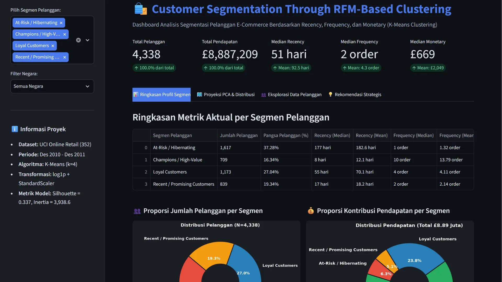
The first tab of the interactive Streamlit dashboard displays global KPIs across all 4,338 customers (£8,887,209 total revenue, 51-day median recency, 2 median orders, and £669 median spend), a comparative RFM summary table per segment, and side-by-side donut charts contrasting customer population share against revenue contribution.

### 2. 2D PCA Projection & Feature Distribution Explorer (Tab 2)
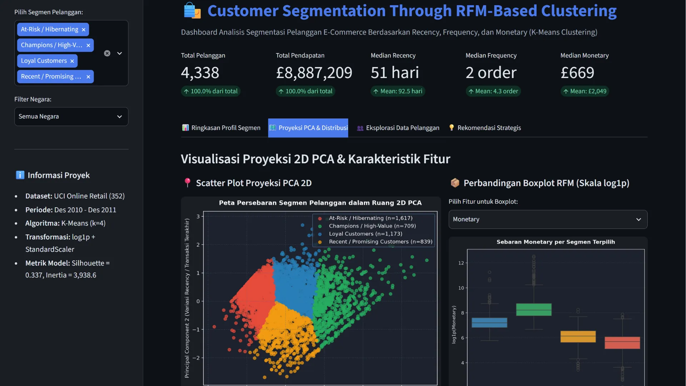
Tab 2 renders an interactive 2D PCA scatter plot alongside a selectable `log1p` boxplot comparison across segments, visually confirming clear separation of Champions on high `PCA1` coordinates and showing substantially elevated `log1p(Monetary)` medians relative to Recent and At-Risk clusters.

### 3. Segmented Customer Data Explorer (Tab 3)
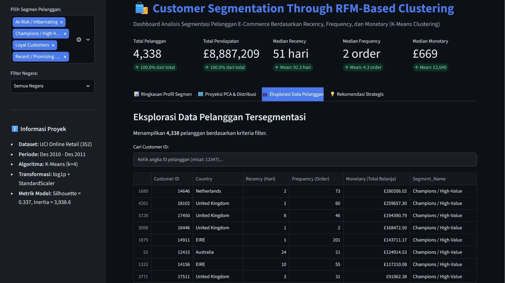
Tab 3 provides a searchable, filterable customer-level table sorted by total spend (`Monetary`), highlighting top wholesale Champion accounts across the Netherlands, United Kingdom, EIRE, and Australia with direct CSV download capability.

### 4. Segment-Specific Strategic Recommendations (Tab 4)
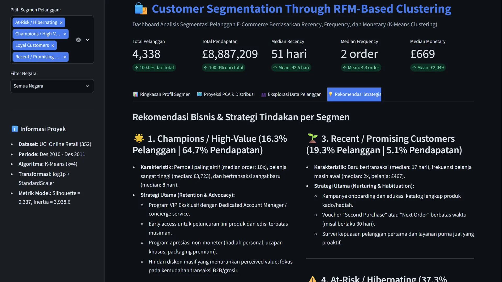
Tab 4 translates cluster profiles into targeted operational playbooks, pairing Champions (16.3% customers, 64.7% revenue) with VIP concierge retention, Loyal Customers with tiered upselling, Recent Buyers with onboarding vouchers, and At-Risk accounts with cost-capped win-back outreach.

### 5. Customer Share vs. Revenue Contribution (Pareto Analysis)
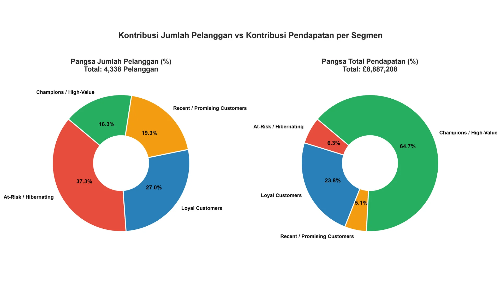
Dual donut charts expose a pronounced Pareto imbalance: `Champions / High-Value` (16.3%) and `Loyal Customers` (27.0%) together account for 43.4% of the customer base while generating 88.5% of total revenue (£8,887,208), whereas the largest segment (`At-Risk / Hibernating`, 37.3%) contributes only 6.3%.

### 6. 2D PCA Cluster Map & Elbow Curve (Inertia vs. `k`)
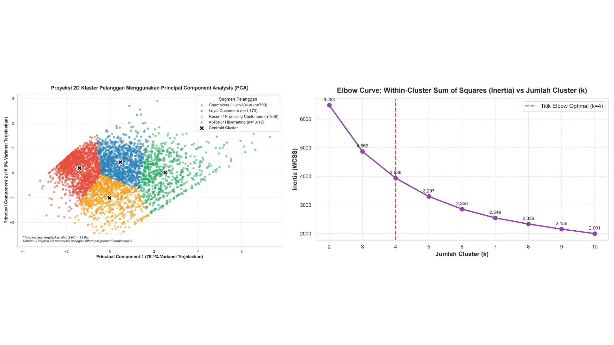
The left panel maps all four clusters and black centroid markers (`X`) across `PC1` (75.1% variance) and `PC2` (18.8% variance), preserving 93.9% of total variance, while the right panel plots Within-Cluster Sum of Squares (Inertia) from `k = 2` (6,484) to `k = 10` (2,001), pinpointing the optimal elbow inflection at `k = 4` (Inertia = 3,939).

### 7. Internal Clustering Metrics & `log1p` RFM Outlier Boxplots
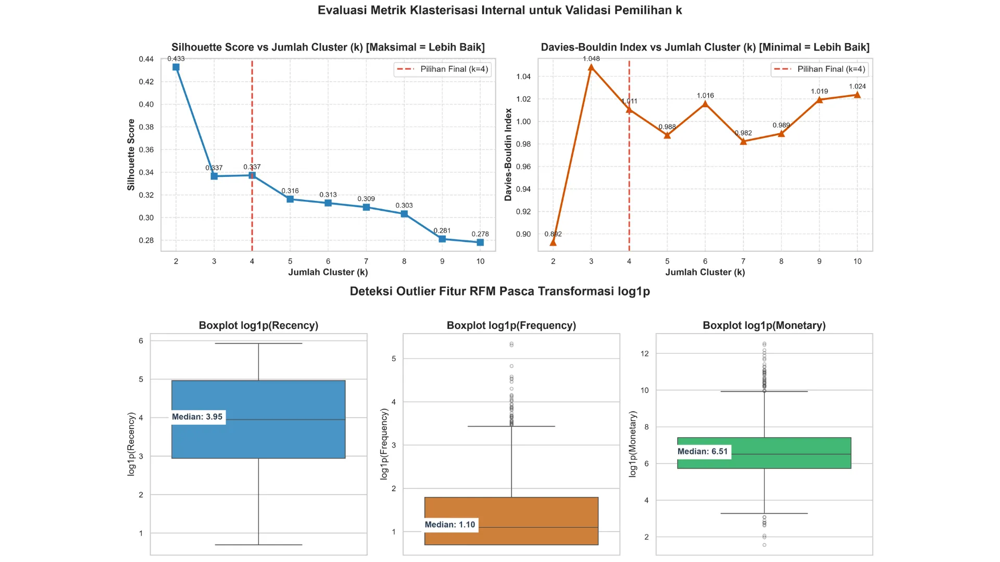
The upper panels confirm `k = 4` as the best post-binary choice with a Silhouette Score peak of 0.337 and an improved Davies-Bouldin Index of 1.011 compared to `k = 3` (1.048), while the lower boxplots illustrate `log1p`-compressed medians (`Recency` = 3.95, `Frequency` = 1.10, `Monetary` = 6.51) with residual upper-tail wholesale outliers.

### 8. Monthly Transaction Volume & Revenue Trend
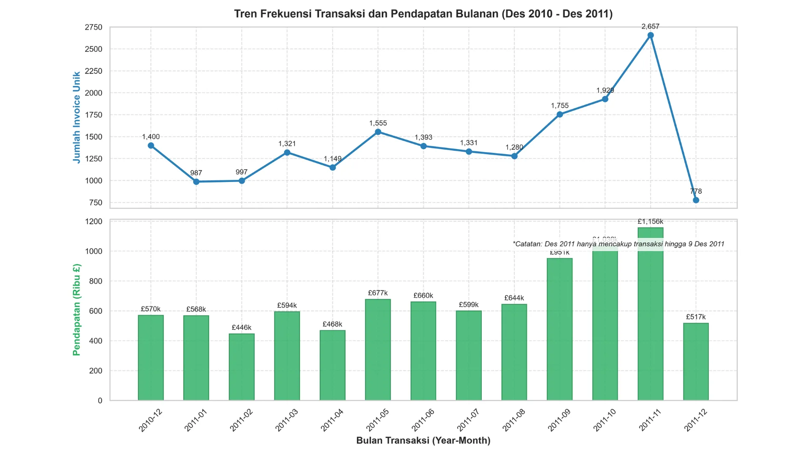
Dual time-series charts track monthly unique invoices and revenue from December 2010 to December 2011, revealing strong Q4 seasonality peaking in November 2011 at 2,657 unique invoices and £1,156k in revenue (with December 2011 reflecting partial data through 9 December).

### 9. RFM Feature Distributions Before vs. After `log1p` Transformation
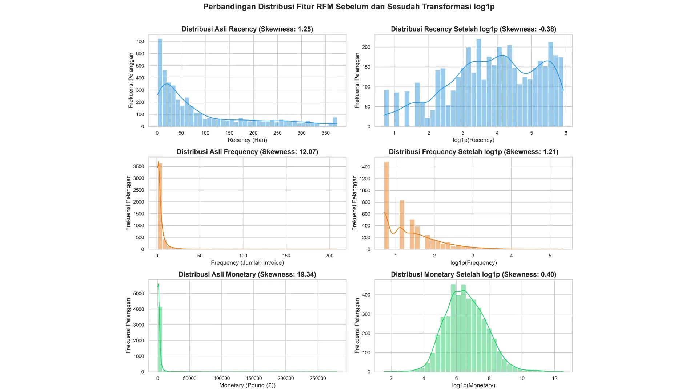
A 3×2 histogram grid contrasts heavily right-skewed raw features (`Recency` skewness 1.25, `Frequency` 12.07, `Monetary` 19.34) against `log1p`-transformed distributions (`Recency` -0.38, `Frequency` 1.21, `Monetary` 0.40), demonstrating near-Gaussian symmetry on Monetary to satisfy K-Means distance assumptions.

### 10. Missing Values Audit & Multivariate Pearson Correlation Heatmaps
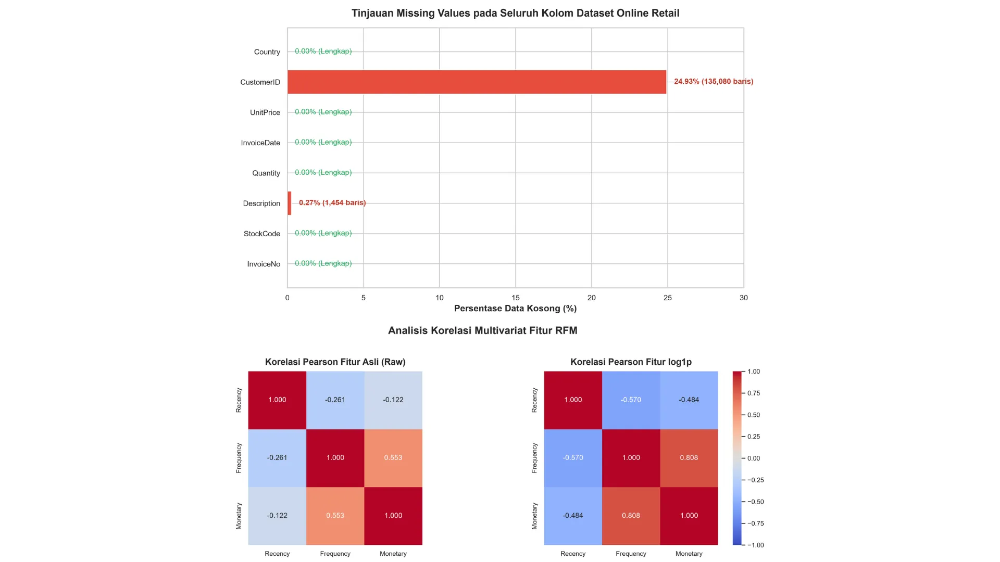
The top chart documents missing data concentrated strictly in `CustomerID` (24.93%, 135,080 rows) and `Description` (0.27%, 1,454 rows), while the bottom correlation matrices show `log1p` transformation strengthening linear structure (`Frequency`–`Monetary` rises from 0.553 to 0.808 and `Recency`–`Frequency` strengthens from -0.261 to -0.570).

### 11. Segment Behavioral Profile Heatmap (Z-Score) & Normalized Medians
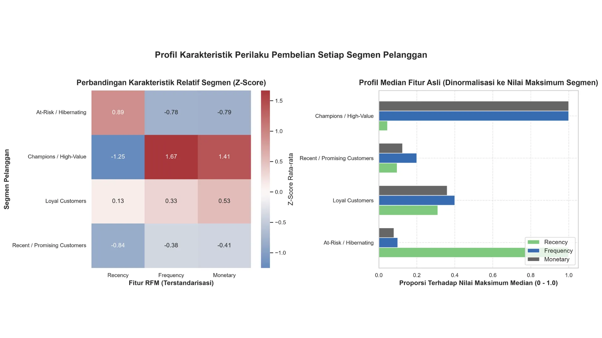
The Z-score heatmap highlights clear behavioral polarity across segments (`Champions`: Recency `-1.25`, Frequency `+1.67`, Monetary `+1.41`; `At-Risk`: Recency `+0.89`, Frequency `-0.78`, Monetary `-0.79`), paired with a horizontal bar comparison of median RFM proportions normalized to each metric's segment maximum.

## Prerequisites

- **Operating System**: Windows, macOS, or Linux (CPU execution only; no GPU or CUDA required)
- **Python Runtime**: Python 3.x (tested in environment with Python `3.15.1` as documented in [final_report.md](final_report.md))
- **Core Python Packages** ([requirements.txt](requirements.txt)): `pandas==3.1.1`, `numpy==2.5.4`, `scikit-learn==1.9.1`, `matplotlib==3.11.2`, `seaborn==0.13.2`, `streamlit==1.67.0`
- **Dataset**: [dataset/original/Online_Retail.csv](dataset/original/Online_Retail.csv) (already included in the repository)

## Installation & Setup

1. Clone the repository and navigate to the project root:
   ```bash
   git clone https://github.com/weztcy/Customer-Segmentation-Through-RFM-Based-Clustering.git
   cd "Customer Segmentation Through RFM-Based Clustering"
   ```
2. Create and activate a virtual environment:
   ```bash
   python -m venv .venv
   # Windows PowerShell
   .\.venv\Scripts\Activate.ps1
   # macOS / Linux
   source .venv/bin/activate
   ```
3. Install the exact pinned dependencies from [requirements.txt](requirements.txt):
   ```bash
   pip install -r requirements.txt
   ```

## Usage & Execution

You can either launch the pre-computed interactive Streamlit dashboard immediately or re-run the full clustering pipeline script.

1. **Launch the Interactive Streamlit Dashboard**:
   Run from the project root so [streamlit/app.py](streamlit/app.py) resolves `dataset/customer_segments.csv` and `dataset/model_metrics.csv`:
   ```bash
   python -m streamlit run streamlit/app.py
   ```
   Open `http://localhost:8501` in a browser to filter segments or countries, inspect PCA projections and boxplots, search individual `CustomerID` records, and export filtered CSV tables.
2. **Run the End-to-End Segmentation Pipeline**:
   Note that [src/customer_segmentation.py](src/customer_segmentation.py) looks for `Online_Retail.csv` in the working directory or `dataset/Online_Retail.csv` and writes generated CSVs to `outputs/` and PNGs to `visualizations/`. Copy or symlink the raw dataset path before running from the repository root:
   ```bash
   # Ensure dataset/Online_Retail.csv is accessible to the script, then run:
   python src/customer_segmentation.py
   ```

## Reproducibility & Execution

Deterministic behavior across cleaning, clustering, and 2D PCA projection is enforced in [src/customer_segmentation.py](src/customer_segmentation.py) using pinned library versions in [requirements.txt](requirements.txt) and fixed random seeds (`RANDOM_STATE = 42`).

1. **Fixed Reference Date**: Recency calculations always anchor to `max(InvoiceDate) + 1 day` (`2011-12-10 12:50:00`) derived deterministically from [dataset/original/Online_Retail.csv](dataset/original/Online_Retail.csv).
2. **Seeded Initialization & Multi-Seed Verification**: Both `KMeans(n_clusters=k, random_state=42, n_init=20)` and `PCA(n_components=2, random_state=42)` fix `random_state=42`; stability tests across seeds `[10, 99, 123, 777, 2024]` verify a mean ARI of `0.9603` against the baseline partition.
3. **Output Verification**: Running the pipeline regenerates `rfm_customer.csv`, `model_metrics.csv`, `customer_segments.csv` (stored in [dataset/](dataset)), and all 10 diagnostic figures (stored in [figures/](figures)), matching the benchmarks reported in [final_report.md](final_report.md). Minor floating-point variance may occur if executed on significantly different NumPy or Scikit-Learn versions outside [requirements.txt](requirements.txt).

## Contributing

Contributions are welcome to improve feature engineering, experiment with alternative clustering algorithms, or enhance the dashboard experience.

1. Fork the repository.
2. Create a branch for the change.
3. Make the changes.
4. Run relevant checks or tests when available.
5. Commit and push the branch.
6. Open a pull request with a clear explanation.

## License

This project is licensed under the MIT License.
See the [LICENSE](LICENSE) file for details.

## Author & Contact

**Yohanes Dimas Pratama**

- GitHub: [github.com/weztcy](https://github.com/weztcy)
- Portfolio: [yohanesdimas.com](https://yohanesdimas.com)
- LinkedIn: [linkedin.com/in/yohanes-dimas](https://www.linkedin.com/in/yohanes-dimas)
